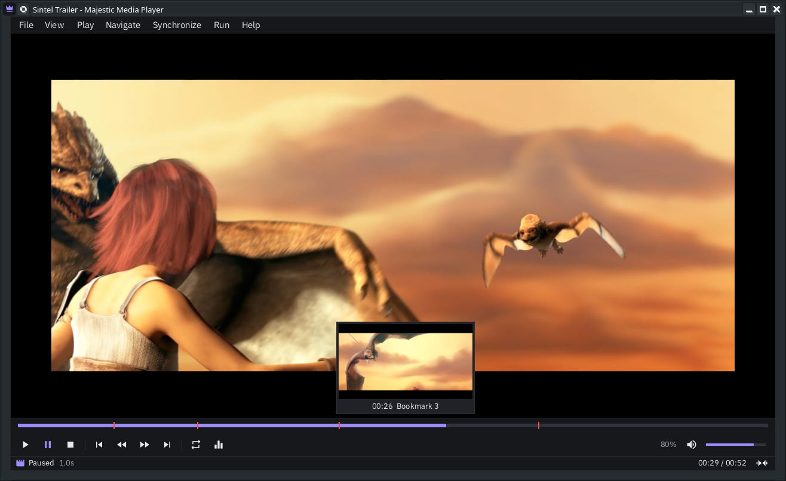

# Majestic Media Player



Inspired by Media Player Classic Home Cinema, built on [libmpv](https://mpv.io) with
[Silky](https://github.com/treeform/silky) UI, vibecoded in Nim.

Majestic's aim is to be the video player I wish I had.

## Features

- **Commands from bookmarks, chapters and loops.** Cut clips, crop, measure the time between two marks, or run anything else you can type in a terminal.
- **YouTube and other online videos** through yt-dlp, timestamps and playlists included. Pick the stream quality, or save the video to disk.
- **Drag & drop or Ctrl+V to open** files and links alike. Ctrl+C copies what's open; Shift+Ctrl+C copies it with the current timestamp.
- **Bookmarks** on the seek bar: snap to them, use them in commands, or embed them as MKV chapters.
- **Seek bar previews** of the spot under the cursor.
- **Synchronized players**, for footage recorded from several angles.
- **VR / 360° videos.**
- **A very, VERY resizable compact mode.**
- **Zoom, pan and rotate** the video (Ctrl+mouse).
- **A-B loops, ping-pong playback and an equalizer.**

Hold Ctrl, Shift or Alt to see what else you can do, or press F1 for every shortcut. Try right-clicking everything, too!

## Install

### Linux (CachyOS / Arch)

```sh
git clone https://github.com/arkl1te/majestic-media-player.git
cd majestic-media-player
./install.sh
```

Then search for **Majestic Media Player** in your application launcher, or right-click a video → Open With.

### Windows

Install [Git for Windows](https://gitforwindows.org), [Nim](https://nim-lang.org) 2.2+ and Visual Studio (or its Build Tools) with the C++ workload. Then, from Git Bash:

```sh
git clone https://github.com/arkl1te/majestic-media-player.git
cd majestic-media-player
./install.sh
```

Majestic shows up in the Start menu.

To update on either platform, `git pull` and run `./install.sh` again. `./install.sh --uninstall` removes it.

More details in [TECHNICAL.md](TECHNICAL.md).

---

<sub>Screenshot: [Sintel](https://durian.blender.org) trailer, © Blender Foundation, CC BY 3.0.</sub>
