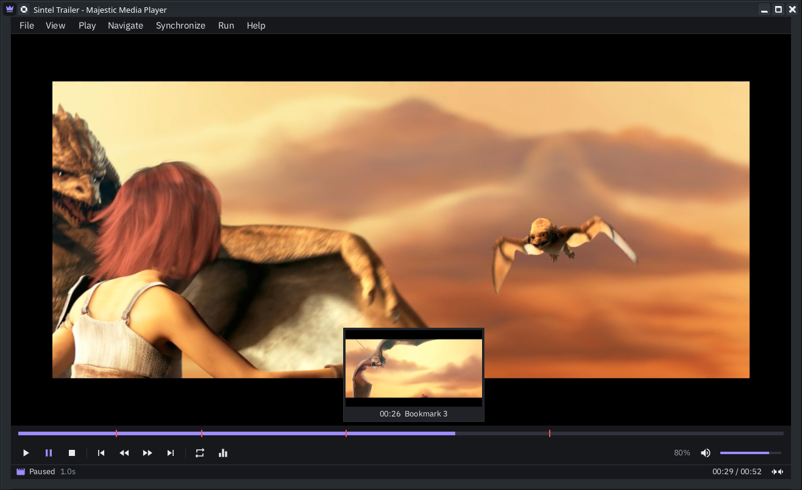

# Majestic Media Player



Inspired by Media Player Classic Home Cinema, built on [libmpv](https://mpv.io) with
[Silky](https://github.com/treeform/silky) UI, vibecoded in Nim.

Majestic's aim is to be the video player I wish I had.

## Features

- **Commands from bookmarks, chapters and loops.** Cut clips, crop, measure the time between two marks, or run anything else you can type in a terminal.
- **YouTube and other online videos** through yt-dlp, timestamps and playlists included. Pick the stream quality, or save the video to disk.
- **Drag & drop or Ctrl+V to open** files and links alike. Ctrl+C copies what's open; Shift+Ctrl+C copies it with the current timestamp.
- **Bookmarks** on the seek bar: snap to them, use them in commands, or embed them as MKV chapters.
- **Seek bar previews** of the spot under the cursor, YouTube videos included.
- **Seek bar shows what's downloaded** of online videos: parts skipped over are striped.
- **Tracker music** (MOD, S3M, XM, IT, MPTM and dozens more) through libopenmpt, with its patterns scrolling in the video frame as they play, a pitch shift, and samples that can keep their own speed while the tempo changes.
- **MIDI music** (MID, RMI, KAR, and DOS games' HMI and XMI songs, played the way their sound engines did) through FluidSynth with a SoundFont from the file's folder or Options, laid out like tracker patterns as it plays.
- **A visualizer that plays AVS presets** for music without a picture, a callback to the Winamp era: a port of Advanced Visualization Studio 2.81d from the source Nullsoft released under a BSD license in 2005, with the presets that came with it and any `.avs` preset you add, playing to the sound you hear ([links to AVS downloads are here!](AVS.md)). Rate presets with up to five stars and search them by name, author, file name or rating. Presets made on slower computers that play too fast can be slowed down, each to a frame rate of its own.
- **Animated covers** for music (GIF, APNG and WebP), moving at their own pace, whether the picture is in the file's tags or beside it. A picture named after the song (`song.jpg` beside `song.mp3`) can be shown instead of the folder's `folder.jpg`.
- **Quick covers**: drop a picture on the video frame, or paste one (a file or a copied image), while music plays (or a video with its video track off) and it shows as the cover, still or animated. Save Quick Cover in the right-click menu brings it back whenever that file opens.
- **Cue sheets**: an album ripped to one file (FLAC, WAV, APE...) with a .cue beside it shows up in the playlist as its tracks, with their titles, artists and lengths, whether you open the .cue, the audio file or the folder. Sheets naming a .wav that was later compressed to FLAC work too.
- **ReplayGain**: songs play at the same loudness (track or album gain) from the values in their tags, with a button showing whether the open file has them. Files without values can get them: the playlist measures the selected songs (as single tracks or as one album), or the ReplayGain button the open one, and saves the values into their tags.
- **Several playlists, foobar2000-style**: tabs (or a side column) you rename, reorder and drag entries between (Shift moves them), a playback queue, Undo/Redo for every playlist edit, closed playlists brought back with Ctrl+Shift+T, and Send to Playlist, Crop, Remove Duplicates and Remove Missing Files. Playback goes on in the playlist that's playing while you browse another, and every playlist is kept between runs.
- **A media library** (View > Library, Ctrl+4) under the playlist: libraries of folders and files (Video, Music and Sounds to start with, more in Options > Libraries, each listing audio, video, everything or the types you pick), searched with tags like `in:Music, artist:name, size biggerthan:1GB, dimension biggerthan:720p, dc:>2025-06` (date created), with the playlist's columns and an optional grouping by folder. Each library expands into a tree of its folders that hold media, and a click on a folder lists what's in it. Folders are scanned in the background at idle priority, once however many libraries share them, names first and tags after, with a progress bar; a network share or a drive that stops answering is reported as not responding, never freezing the player.
- **A tag editor** (the playlist's Properties...): edit the selected files' tags in a grid, fill them in from the file names, number tracks in playlist order, and see what else a file holds, a tracker module's message and sample names included.
- **File names and tags in any language, emoji included**: Japanese, Chinese, Korean, Russian and more show up in the playlist, library, menus and dialogs, drawn with the fonts already on your system (Japanese and Chinese characters each take their own language's forms), and emoji in color.
- **A silent delay after very short audio files**, shown on the seek bar past a `]` mark.
- **Synchronized players**, for footage recorded from several angles.
- **VR / 360° videos**, YouTube's included (360°, VR180 and 3D).
- **A shield button** that keeps a player's file: while it's on, files opened from the file manager start a new player instead.
- **A command palette** (F3), like Blender's menu search: type part of any command's name (menus, the controls bar's buttons and their right-click menus, the playlist's menu for the file playing) and run it with Enter. Submenus open right in the palette, so recent files (the last 50, Del removes one), tracks or chapters are a few keys away. Toggles stay open, so you can flip several in a row. Disable Audio and Disable Video turn the track off and back to the one you had. Change Visualizer lists the visualizer presets and plays each one as you move through the list; Esc puts back the one you had.
- **A very, VERY resizable compact mode.**
- **Zoom, pan and rotate** the video (Ctrl+mouse).
- **A-B loops, ping-pong and reverse playback, and an equalizer.** Turn on Enable reverse playback in the Play button's right-click menu, and clicking Play while playing plays backward. It turns around at once: the sound goes back from the very spot heard, the wave carrying on with no gap, and a video turns as soon as its picture is ready going the other way, a fraction of a second later.
- **Play/Pause, Previous and Next in the taskbar's window preview**, on Windows and KDE Plasma.

Hold Ctrl, Shift or Alt to see what else you can do, or press F1 for every shortcut. Try right-clicking everything, too!

## Install

### Linux (any distribution): AppImage

Download the `.AppImage` from the [latest release](https://github.com/arkl1te/majestic-media-player/releases/latest), make it executable (right-click → Properties → Allow executing, or `chmod +x`) and run it. It needs nothing installed: it brings everything it uses along. Making it the default player in Options > Formats also adds it to your application launcher, and Help > Check for Updates replaces it with the new release in place.

### Linux from source (CachyOS / Arch)

```sh
git clone https://github.com/arkl1te/majestic-media-player.git
cd majestic-media-player
./install.sh
```

Then search for **Majestic Media Player** in your application launcher, or right-click a video → Open With.

### Windows

Download the `-windows-x64.zip` from the [latest release](https://github.com/arkl1te/majestic-media-player/releases/latest), extract it anywhere and run `majestic-media-player.exe`. Nothing else needs to be installed. Help > Check for Updates installs new releases for you.

### Windows from source

Install [Git for Windows](https://gitforwindows.org), [Nim](https://nim-lang.org) 2.2+ and Visual Studio (or its Build Tools) with the C++ workload. Then, from Git Bash:

```sh
git clone https://github.com/arkl1te/majestic-media-player.git
cd majestic-media-player
./install.sh
```

Majestic shows up in the Start menu.

To update a source install, `git pull` and run `./install.sh` again. `./install.sh --uninstall` removes it.

### If it crashes

Majestic writes what went wrong to `crash.log`, in `~/.config/majestic-media-player/` on Linux and `%APPDATA%\majestic-media-player\` on Windows (the error message says where). Please attach that file when you report the crash. It includes the path of the file that was open.

## More reading

- [TECHNICAL.md](TECHNICAL.md): install options, building by hand, how the player works inside, the source layout and debugging tips.
- [AVS.md](AVS.md): where to get the AVS preset packs I rated highest, for the visualizer.
- [CLAUDE.md](CLAUDE.md): the original brief Majestic was built from (menus, layout and behavior).

## Credits

The AVS visualizer is ported from the source of Advanced Visualization Studio 2.81d that Nullsoft released under a BSD license in 2005 ([visbot/vis_avs](https://github.com/visbot/vis_avs)), with some third-party effects following [grandchild's fork](https://github.com/grandchild/vis_avs) and the Convolution Filter by [Tom Holden](https://github.com/tholden/AVSConvolutionFilter). Their licenses are in [assets/licenses/AVS-Nullsoft-BSD.txt](assets/licenses/AVS-Nullsoft-BSD.txt). Majestic isn't affiliated with or endorsed by Winamp or Nullsoft.

---

<sub>Screenshot: [Sintel](https://durian.blender.org) trailer, © Blender Foundation, CC BY 3.0.</sub>
